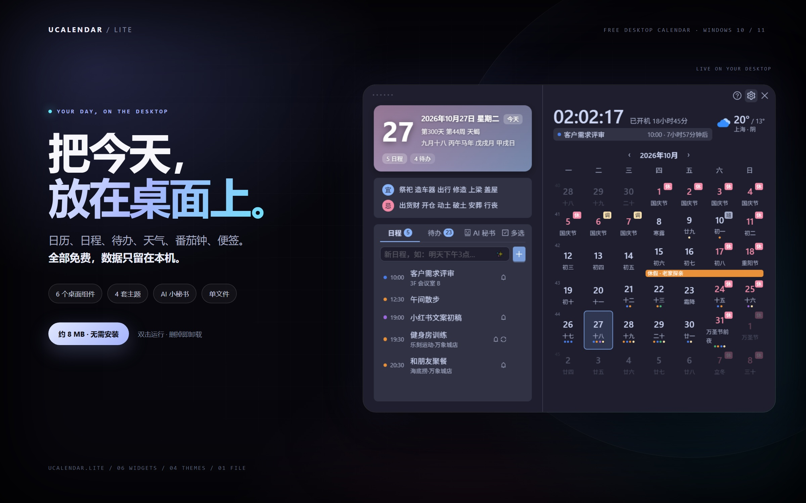
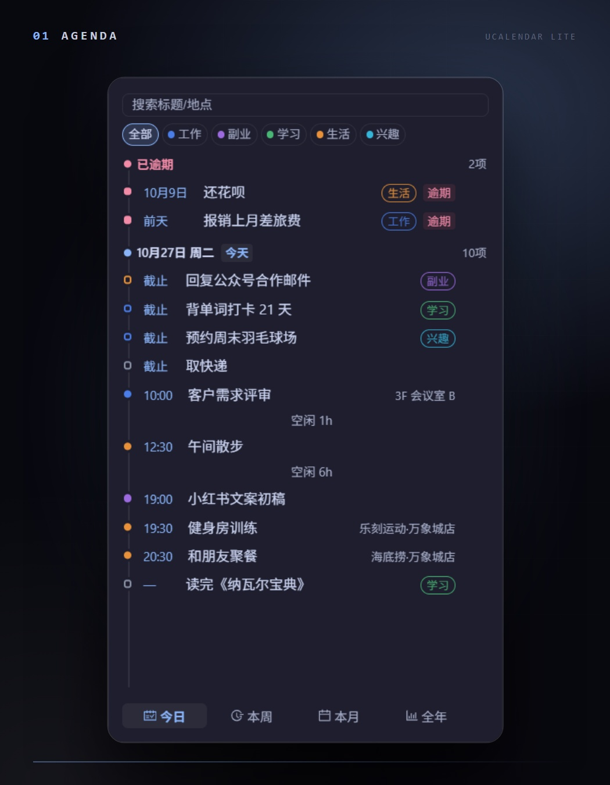
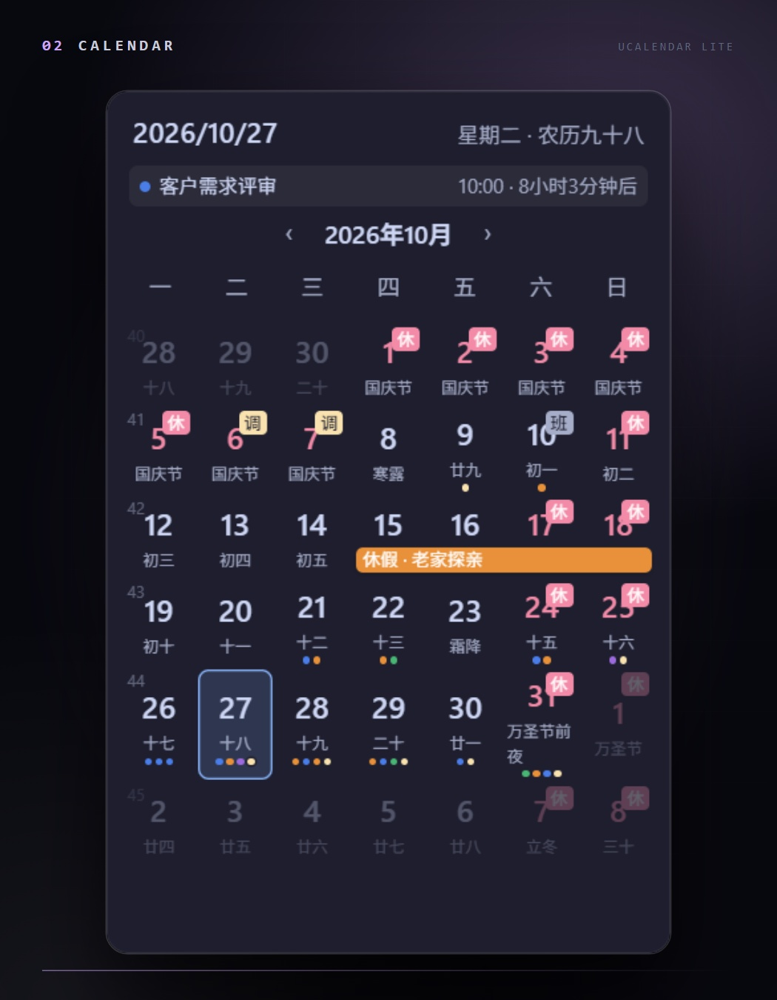
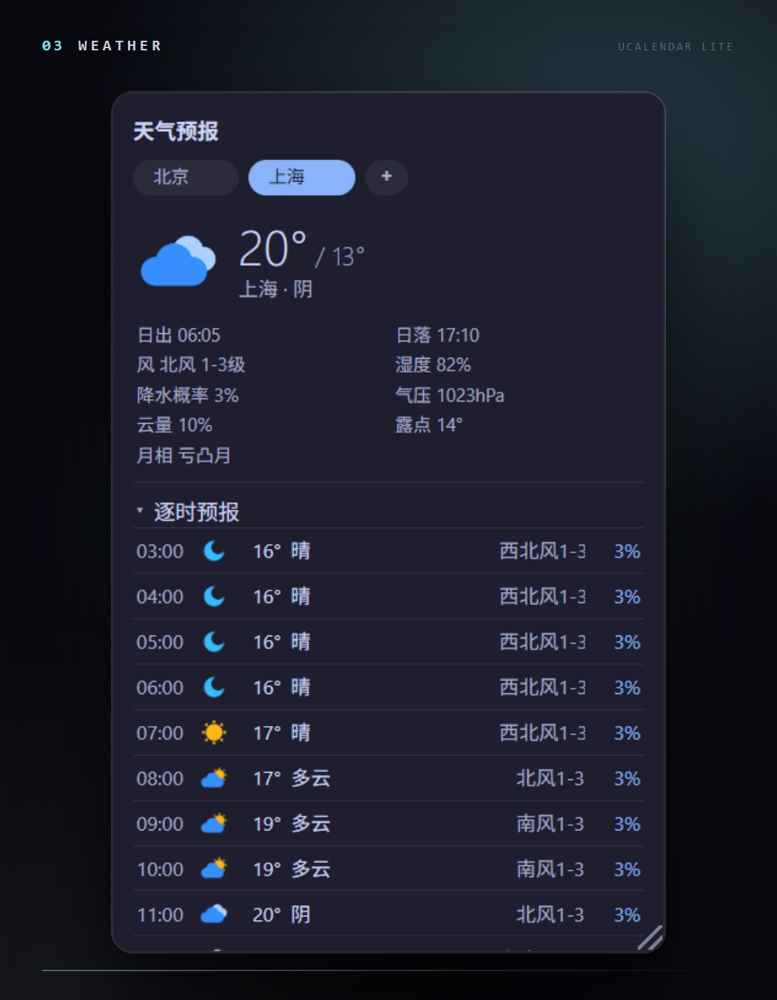
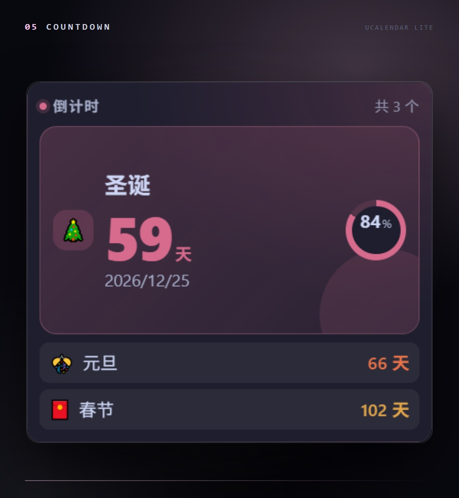
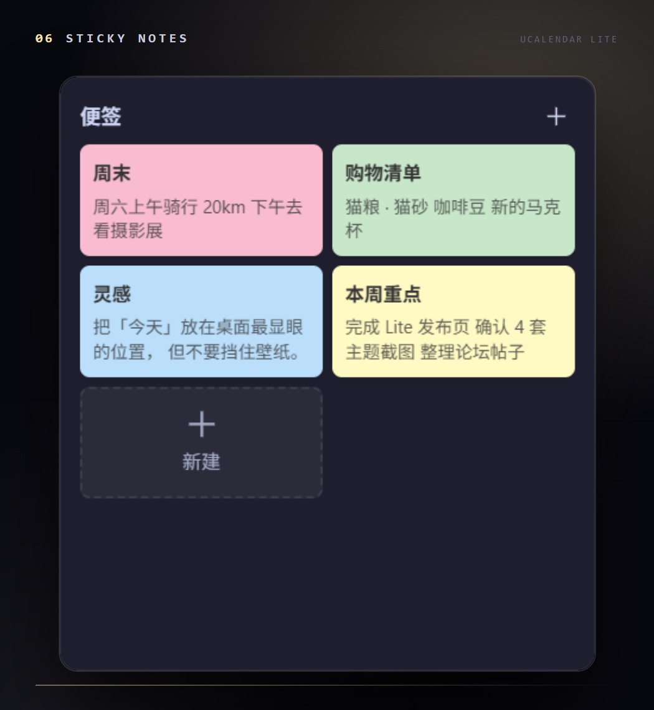
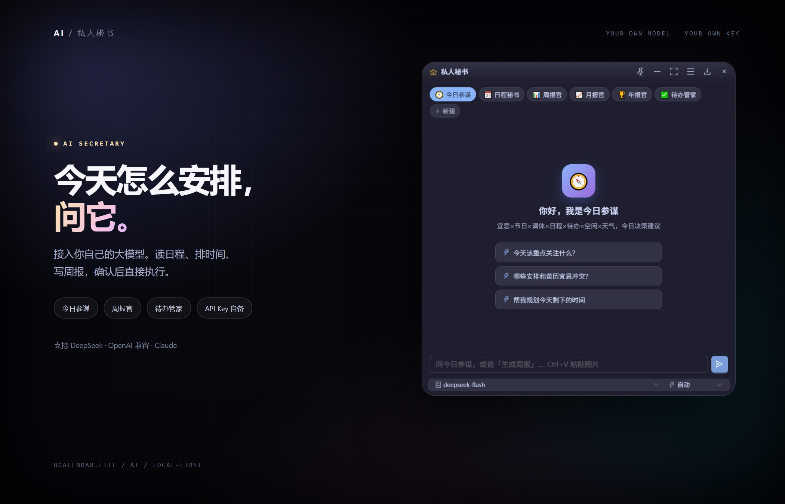
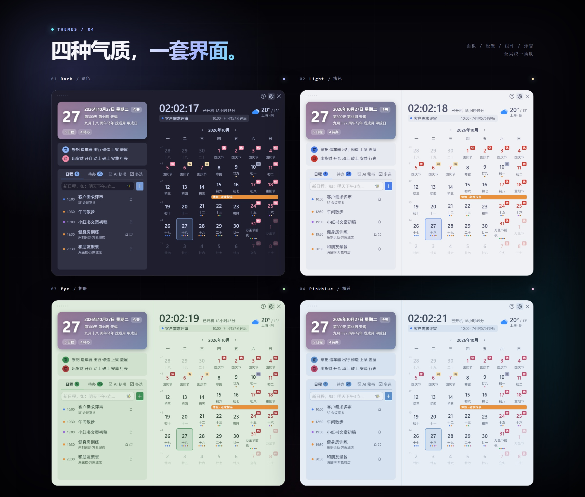
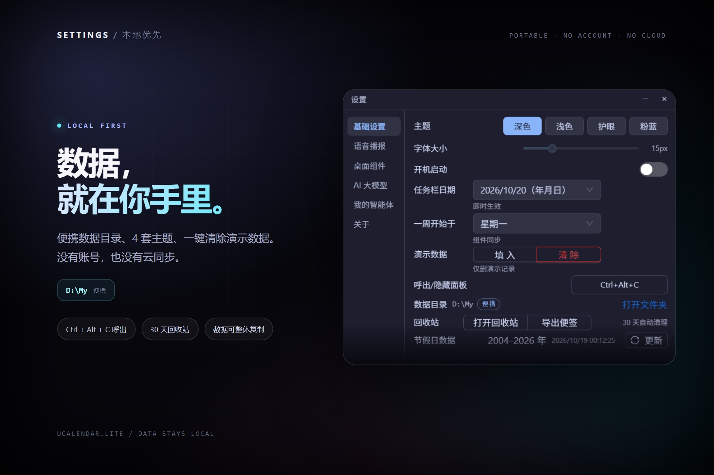

# UCalendar Lite

**Windows 桌面日历 · 任务栏时钟 · 6 个桌面组件 · AI 小秘书**

单文件绿色版，双击即用。日历、日程、待办、天气、番茄钟、便签住在桌面上；点任务栏时钟，今天的一切就在眼前。

[项目主页](https://tobaba.github.io/ucalendar-site/) · [下载](https://github.com/tobaba/ucalendar-lite/releases/latest/download/UCalendar-Lite.exe) · [反馈](https://github.com/tobaba/ucalendar-lite/issues)

  

## 一眼看懂

- **任务栏时钟即入口**：左键呼出面板，右键是快捷菜单（组件开关 / 解除穿透 / 开机启动 / 退出）
- **6 个桌面组件**：日程、月历、天气、番茄钟、倒计日、便签，拖到顺手的位置
- **能真正干活的 AI 小秘书**：读写日程与待办，不只是聊天
- **单文件、不登录、无广告**：数据保存在本机，删掉 exe 即卸载

## 桌面组件

<table>
<tr>
<td width="50%" align="center"> <b>今日安排</b> 逾期 / 今天 / 本周 / 本月 / 全年五档视图，日程与待办按时间排好</td>
<td width="50%" align="center"> <b>桌面月历</b> 农历、节气、节假日调休、跨天日程条与日程圆点</td>
</tr>
<tr>
<td align="center"> <b>天气预报</b> 实时天气 + 24 小时逐时 + 3 天预报，多城市切换</td>
<td align="center"> <b>番茄钟</b> 专注 / 短休 / 长休周期可调，结束自动播报</td>
</tr>
<tr>
<td align="center"> <b>倒计日</b> 生日、纪念日、假期与考试，重要日子一眼可见</td>
<td align="center"> <b>待办便笺</b> 随手记的彩色便签，常驻桌面，不用打开主面板</td>
</tr>
</table>

全部组件支持：拖动、缩放、透明度、锁定位置、鼠标穿透（不挡桌面操作）。

## 日历与提醒

- 月历 + **农历 / 节气 / 节假日调休 / 黄历宜忌**
- 日程支持自然语言输入、重复规则、提前提醒；待办四档优先级、逾期标记
- **语音播报**：整点报时、久坐提醒、日程提醒，可换音色与语速
- 日程 / 待办 / 便签删除后保留 30 天，可搜索、恢复、彻底删除
- 全局热键呼出（默认 `Ctrl+Alt+C`）、开机自启、常驻系统托盘

## AI 小秘书

  

- **一句话建日程**：说「明天下午三点开会 在会议室 A」，确认后直接写进日历
- **预设助手即开即用**：今日参谋、日程秘书、待办管家、周报官、月报官、年报官
- **多服务商**：DeepSeek、任意 OpenAI 兼容接口、Claude 均可；API Key 自己填，只存本机
- **安全边界**：写日程、删数据、执行命令都要弹窗确认；文件操作限定在工作目录

## 4 套主题

深色 / 浅色 / 护眼 / 粉蓝，面板、设置、组件、弹窗统一换肤。

  

想要世界时钟、秒表、时间进度、工作区预设和 14 套主题，并跟上后续新增功能？[在项目主页查看 Lite 与 Pro 的差异](https://tobaba.github.io/ucalendar-site/?from=lite#editions)。Lite 会长期维护现有免费功能。

## 数据与设置

  

主题、字体大小、快捷键、演示数据与数据目录都在同一页；复制数据目录即可迁移。截图中的 `D:\My` 是便携目录示例。

## 下载

**[下载 UCalendar Lite](https://github.com/tobaba/ucalendar-lite/releases/latest/download/UCalendar-Lite.exe)**（约 7.8 MB）

1. 下载 `UCalendar-Lite.exe`，双击运行，**无需安装**
2. 左键点任务栏时钟呼出面板；右键时钟是快捷菜单
3. 数据默认保存在 `%LOCALAPPDATA%\UCalendar`；exe 同目录有 `data\` 时优先使用便携目录

运行要求：Windows 10 / 11 + WebView2 运行时（Win11 与装过 Edge 的系统已自带）。

本项目完全免费，没有广告、登录或订阅。

## 常见问题

**杀毒 / 系统提示未知发布者？** 个人项目未购买代码签名证书，可从 Releases 页面下载并核对文件大小。

**AI 功能必须联网吗？** 需要 API Key 与你选择的服务商；不配置时其余功能照常使用。

**换电脑怎么迁移数据？** 复制 `%LOCALAPPDATA%\UCalendar`（或便携目录）即可，全部数据都在里面。

**支持哪些系统？** Windows 10 / 11 为官方支持。

---

[项目主页](https://tobaba.github.io/ucalendar-site/) · [更新记录](https://github.com/tobaba/ucalendar-lite/releases) · [问题反馈](https://github.com/tobaba/ucalendar-lite/issues)
