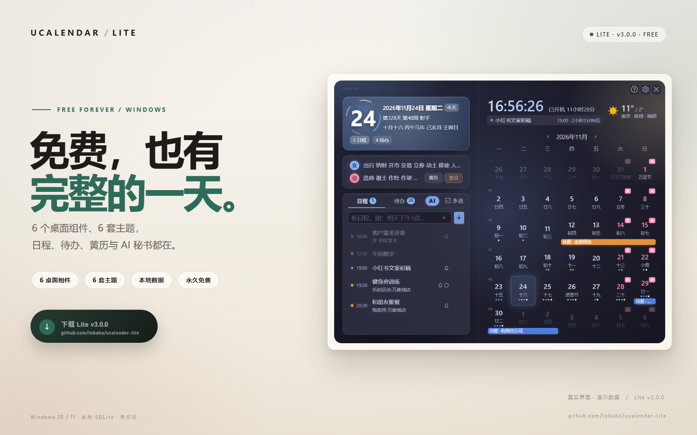
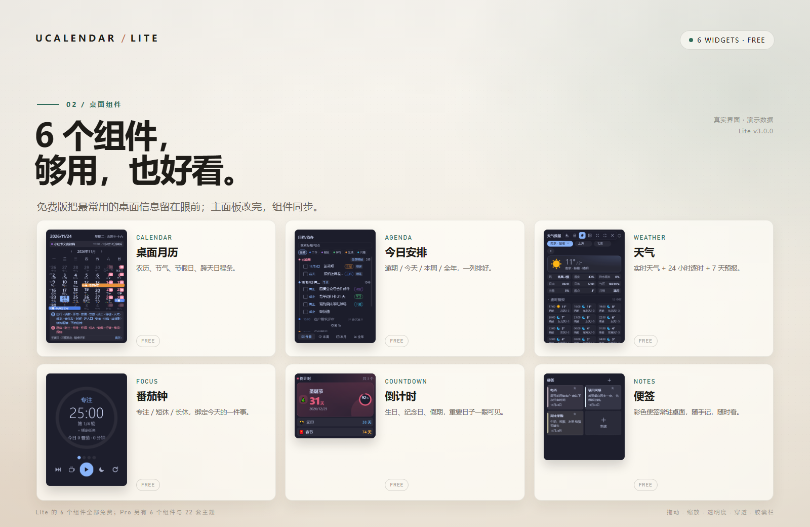
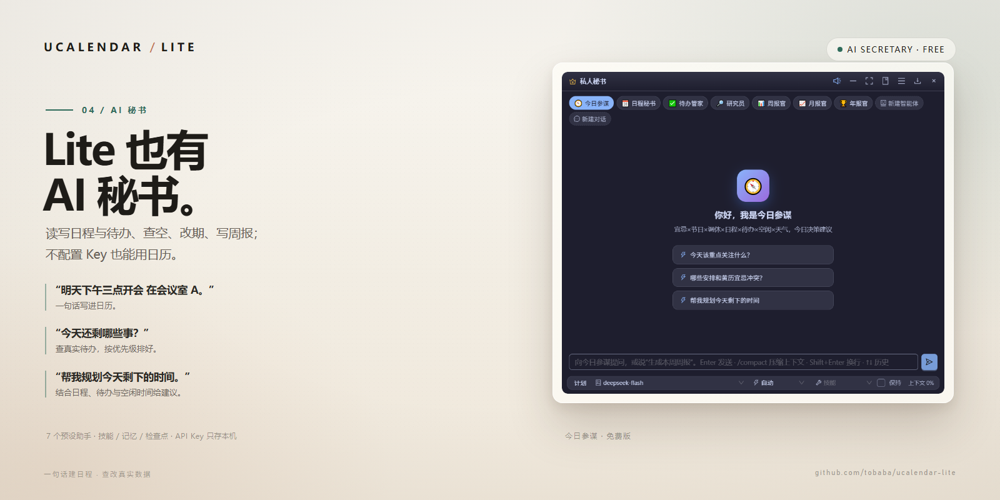
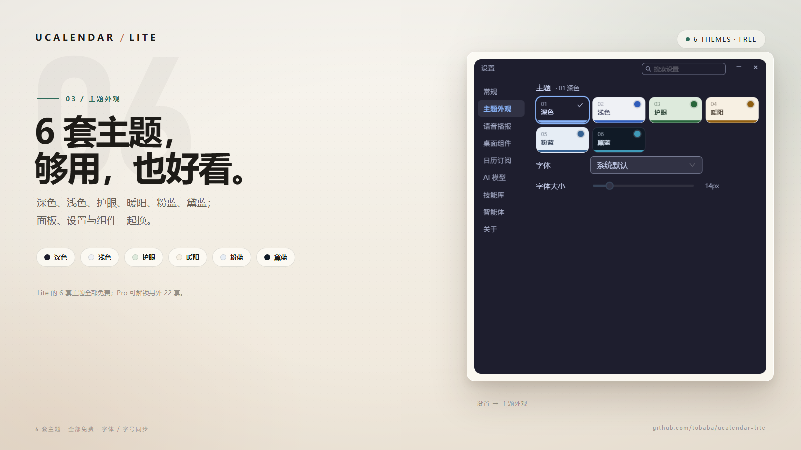

# UCalendar Lite

**Windows 桌面日历 · 任务栏时钟 · 6 个桌面组件 · 6 套主题 · AI 小秘书**

单文件绿色版，双击即用。日历、日程、待办、天气、番茄钟、便签住在桌面上；默认深色主题，点任务栏时钟，今天的一切就在眼前。当前版本 **v3.0.0**。

[项目主页](https://tobaba.github.io/ucalendar-site/?from=lite) · [下载](https://github.com/tobaba/ucalendar-lite/releases/latest/download/UCalendar-Lite.exe) · [反馈](https://github.com/tobaba/ucalendar-lite/issues)

  

## 一眼看懂

- **任务栏时钟即入口**：左键呼出面板，右键是快捷菜单（组件开关 / 解除穿透 / 开机启动 / 退出）
- **6 个桌面组件**：今日安排、桌面月历、天气、番茄钟、倒计时、便签，拖到顺手的位置
- **能真正干活的 AI 小秘书**：读写日程与待办，支持技能、记忆与检查点，不只是聊天
- **黄历 / 吉日**：1900–2100 离线宜忌、时辰吉凶、吉日筛选，不联网也能查
- **单文件、不登录、无广告**：数据保存在本机，删掉 exe 即卸载
- **Pro 边界**：项目管理、便签管理页属于 Pro；Lite 保留桌面便签与快速记录

## 6 个桌面组件

  

- **桌面月历**：农历、节气、节假日调休、跨天日程条、项目条与日程圆点
- **今日安排**：逾期 / 今天 / 本周 / 本月 / 全年五档视图，日程与待办按时间排好
- **天气**：实时天气 + 24 小时逐时 + 7 天预报，多城市切换
- **番茄钟**：专注 / 短休 / 长休周期可调，结束自动播报
- **倒计时**：生日、纪念日、假期与考试，重要日子一眼可见
- **便签**：彩色便签常驻桌面，随手记，随时看

全部组件支持拖动、缩放、透明度、锁定位置、鼠标穿透；收起后汇总到胶囊栏，点击或悬停展开。

## 日历与提醒

- 月历 + **农历 / 节气 / 节假日调休 / 黄历宜忌**
- **独立黄历 / 吉日窗**：1900–2100 宜忌与释义离线可查；吉日查询可直接加日程
- 日程支持自然语言输入、重复规则、提前提醒；待办四档优先级、逾期标记
- **语音播报**：整点报时、久坐提醒、日程提醒，可换音色与语速
- 日程 / 待办 / 便签删除后保留 30 天，可搜索、恢复、彻底删除
- 所有导出统一走系统“另存为”，默认目录 `<data>/exports`；取消不落盘
- 全局热键呼出（默认 `Ctrl+Alt+C`）、开机自启、常驻系统托盘

## AI 小秘书

  

- **一句话建日程**：说「明天下午三点开会 在会议室 A」，确认后直接写进日历
- **7 个预设助手**：今日参谋、日程秘书、待办管家、研究员、周报官、月报官、年报官
- **自定义智能体**：一句话描述需求，AI 生成提示词、图标、名称和简介，保存后直接出现在列表
- **技能与记忆**：支持 `skills/` 技能、跨会话记忆、AI 检查点与只读研究员
- **多服务商**：DeepSeek、任意 OpenAI 兼容接口、Claude 均可；API Key 自己填，只存本机
- **安全边界**：写日程、删数据、执行命令都要弹窗确认；文件操作限定在工作目录

## 6 套主题

深色（默认）/ 浅色 / 护眼 / 暖阳 / 粉蓝 / 黛蓝，面板、设置、组件、弹窗统一换肤；支持切换字体与字号。

  

想要项目管理、便签管理、微信机器人、世界时钟、秒表、时间进度、项目进度、股票、音乐播放、工作区预设、日迹、时间册导出、今日节奏和 28 套主题？[在项目主页查看 Lite 与 Pro 的差异](https://tobaba.github.io/ucalendar-site/?from=lite#editions)。Lite 会长期维护现有免费功能。

## 数据与设置

主题、字体大小、快捷键、演示数据与数据目录都在同一页；复制数据目录即可迁移。

- 数据默认在 `%LOCALAPPDATA%\UCalendar`；exe 同目录有 `data\` 时优先使用便携目录
- 设置 → 关于：查看版本、数据目录、GitHub 反馈与 Lite / Pro 边界
- 「演示数据」可随时填入或清除，不影响你自己或 AI 创建的日程

## 下载

**[下载 UCalendar Lite v3.0.0](https://github.com/tobaba/ucalendar-lite/releases/latest/download/UCalendar-Lite.exe)**（8.4 MB）

1. 下载 `UCalendar-Lite.exe`，双击运行，**无需安装**
2. 左键点任务栏时钟呼出面板；右键时钟是快捷菜单
3. 数据默认保存在 `%LOCALAPPDATA%\UCalendar`；exe 同目录有 `data\` 时优先使用便携目录

运行要求：Windows 10 / 11 + WebView2 运行时（Win11 与装过 Edge 的系统通常已自带；缺失时首次启动会自动联网安装）。

本项目完全免费，没有广告、登录或订阅。

## 支持

Lite 应用内不显示支持入口；如果它帮到了你，可以在本页扫码支持，完全自愿。

  

扫码付款后请在付款备注中填写邮箱，作者会把支持码发到该邮箱。Pro 版 20 元起，一次支持，长期可用。

## 常见问题

**杀毒 / 系统提示未知发布者？** Lite 已使用 `CN=UCalendar Studio` 代码签名；SmartScreen 首次运行仍可能提示，可从 Releases 页面下载并核对文件大小。

**AI 功能必须联网吗？** 需要 API Key 与你选择的服务商；不配置时其余功能照常使用。

**换电脑怎么迁移数据？** 复制 `%LOCALAPPDATA%\UCalendar`（或便携目录）即可，全部数据都在里面。

**支持哪些系统？** Windows 10 / 11 为官方支持。

**Lite 和 Pro 有什么区别？** Lite 保留日程、待办、月历、今日安排、黄历 / 吉日、便签、6 个桌面组件、6 套主题与 AI；项目管理、便签管理、微信机器人、日迹、时间册导出、今日节奏、6 个 Pro 组件、工作区预设和 22 套高级主题属于 Pro。可在「设置 → 关于」或[项目主页](https://tobaba.github.io/ucalendar-site/?from=lite#editions)查看。

---

[项目主页](https://tobaba.github.io/ucalendar-site/?from=lite) · [更新记录](https://github.com/tobaba/ucalendar-lite/releases) · [问题反馈](https://github.com/tobaba/ucalendar-lite/issues)
